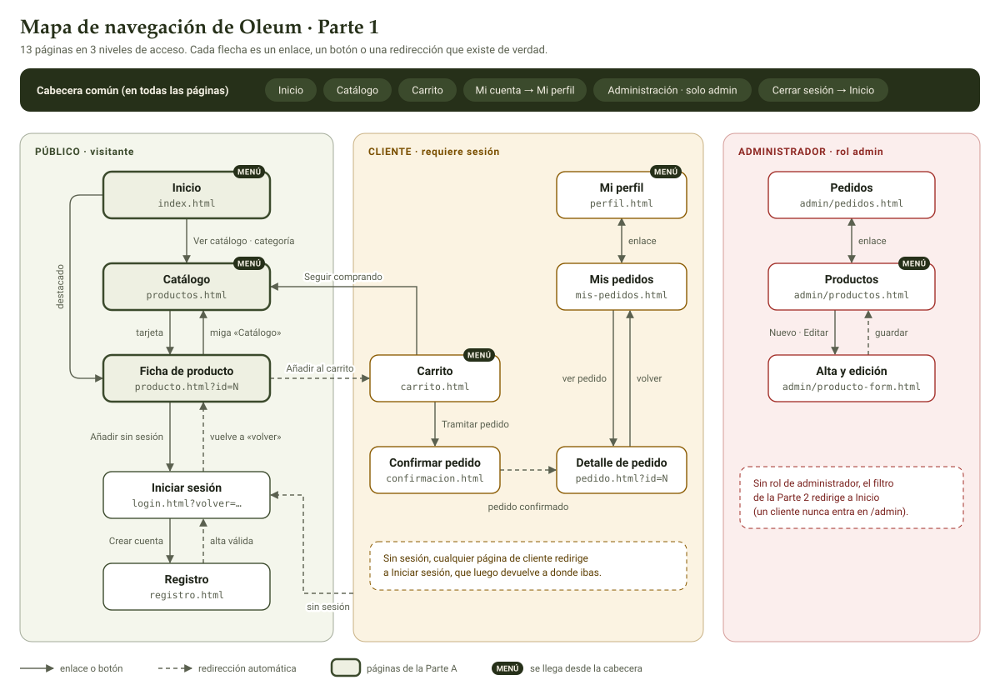

# Memoria · Secciones de la Parte A

**Autor:** Noe (parte A del reparto: inicio, catálogo, ficha de producto y análisis del grupo).

Estas secciones se integran en la memoria común del grupo. Los anexos están en la misma carpeta `memoria/`:

- **Anexo A:** historias de usuario completas, con sus criterios de aceptación (`analisis/historias-visitante.md`).
- **Anexo B:** inventario de páginas y mapa de navegación (`analisis/inventario-y-mapa.md`).
- **Anexo C:** matriz de pruebas y resultados de calidad (`analisis/pruebas-parte-a.md`).
- **Anexo D:** capturas e informes de Lighthouse (`evidencias/`).

---

## 1. Actores y requisitos

Los actores se identificaron con el criterio del enunciado (apartado 2.1): quién usa el sistema y con qué permisos. Se ordenan de menor a mayor privilegio.

| Actor | Qué puede hacer |
| --- | --- |
| Visitante | Consultar el catálogo y las fichas, buscar, filtrar, registrarse e iniciar sesión. |
| Cliente | Lo mismo, y además mantener su carrito, confirmar pedidos, consultar su historial y editar su perfil. |
| Administrador | Mantener productos y categorías, controlar existencias y actualizar el estado de los pedidos. |

El visitante es un actor propio porque no está identificado: solo accede a lo público. Al iniciar sesión pasa a ser cliente, y entonces puede tener carrito y pedidos, que siempre pertenecen a un usuario. Que compre o no es su comportamiento, no su rol.

### Historias de usuario de la Parte A

Cada historia sigue el formato «Como [actor], quiero [acción], para [objetivo]». Tiene criterios de aceptación verificables con un sí o un no, y al menos un caso de error por cada camino feliz. Los criterios completos están en el anexo A, y cada uno tiene su prueba en el anexo C.

| Id | Como visitante, quiero… | para… | Página |
| --- | --- | --- | --- |
| VIS-01 | ver en la portada qué ofrece la tienda y algunos destacados | empezar a explorar sin buscar | Inicio |
| VIS-02 | ver los aceites en un listado | hacerme una idea de lo que vende la tienda | Catálogo |
| VIS-03 | buscar escribiendo una palabra | encontrar rápido un aceite que ya conozco | Catálogo |
| VIS-04 | filtrar por una o varias categorías | ver solo el tipo de aceite que me interesa | Catálogo |
| VIS-05 | filtrar por variedad de aceituna | comparar aceites de la variedad que prefiero | Catálogo |
| VIS-06 | indicar un precio mínimo y uno máximo | ver solo lo que encaja en mi presupuesto | Catálogo |
| VIS-07 | ver qué filtros tengo aplicados y quitarlos | no perderme al combinarlos | Catálogo |
| VIS-08 | moverme entre páginas del catálogo | ver todo sin una lista interminable | Catálogo |
| VIS-09 | que al volver de una ficha el catálogo siga como lo dejé | no repetir la búsqueda | Catálogo |
| VIS-10 | ordenar por precio o por nombre | comparar con más facilidad | Catálogo |
| VIS-11 | ver la ficha completa de un aceite | decidir si lo compro | Ficha |
| VIS-12 | que al intentar comprar se me pida iniciar sesión y luego vuelva a la ficha | no perder lo que estaba mirando | Ficha |
| VIS-13 | usar la portada, el catálogo y la ficha solo con teclado | poder comprar igual que cualquiera | Las tres |
| CLI-01 | *(como cliente)* elegir cuántas unidades añado al carrito | comprar varias de una vez | Ficha |

---

## 2. Inventario de páginas y mapa de navegación

El inventario se obtuvo recorriendo las historias una a una y preguntando «¿en qué página ocurre esto?». Salen 13 páginas en tres niveles de acceso, cada una con un único dueño en el grupo y su ruta equivalente en la Parte 2. La tabla completa y sus comprobaciones están en el anexo B.

*Figura 1. Mapa de navegación. Las zonas son los niveles de acceso. La cabecera común, presente en todas las páginas, se dibuja una vez arriba, y sus destinos llevan la marca MENÚ. Las flechas continuas son enlaces o botones; las discontinuas, redirecciones automáticas (patrón Post/Redirect/Get).*

El mapa cumple las comprobaciones del método visto en clase:

- La entrada es Inicio, y desde ahí se llega a cualquier página.
- Solo se dibujan enlaces que existen o que el grupo ha acordado.
- Los accesos restringidos se marcan con color.
- No hay callejones sin salida, porque todas las páginas llevan la cabecera.

---

## 3. Arquitectura del front-end y decisiones de diseño

La idea que guía todas las decisiones es que el prototipo de la Parte 1 pase a Servlet, JSP y DAO casi sin cambios en la Parte 2.

### 3.1 MVC también en el navegador

El código de la Parte A separa las mismas capas que pide el enunciado para la Parte 2 (apartado 4). Cada módulo de JavaScript tiene una sola responsabilidad y un equivalente directo en el servidor.

| Capa | Parte 1 (navegador) | Responsabilidad | Parte 2 (servidor) |
| --- | --- | --- | --- |
| Modelo | `datos/productos.js` | Solo datos: categorías y productos | Tablas `categoria` y `producto`, `ProductoDAO` |
| Lógica | `catalogo/filtros.js` | Leer criterios, filtrar, ordenar, paginar y validar. Funciones puras, sin DOM | Servicio de productos |
| Vista | `catalogo/vista.js` y los `<template>` del HTML | Crear las tarjetas, las casillas y la paginación | JSP con JSTL (`<c:forEach>`, `<c:out>`) |
| Controlador | `paginas/inicio.js`, `catalogo.js` y `detalle.js` | Leer la URL y los eventos, y coordinar | Servlets |

El recorrido al marcar un filtro es el mismo que hará un Servlet: evento → criterios → URL → filtrar, ordenar y paginar → pintar.

### 3.2 Decisiones principales

| Decisión | Por qué | En la Parte 2 |
| --- | --- | --- |
| Los filtros son un `<form method="get">` y su estado vive en la URL (`productos.html?q=…&categoria=…&pagina=…`) | «Atrás» desde la ficha conserva la selección (VIS-09), un enlace filtrado se puede compartir y la portada enlaza a cada categoría. Al filtrar, la URL se actualiza con `history.replaceState`, para no llenar el historial | Es literalmente `GET /productos` con los mismos parámetros |
| Una sola función, `leerCriterios`, lee la URL y el formulario (`new URLSearchParams(new FormData(form))`) | Un único punto valida todo. Los valores raros de la URL (página 99, precio negativo, categoría inexistente) se ignoran o se corrigen y la página nunca falla | El Servlet leyendo `request.getParameter` |
| Cada filtro es una función pequeña dentro de una lista | Añadir un filtro es añadir una función, sin tocar el resto | Cada filtro, un trozo del `WHERE` con `?` en un `PreparedStatement` |
| Las tarjetas se crean desde un `<template>` y se rellenan con `textContent`; nunca `innerHTML` con datos | El marcado queda en el HTML y se evita el XSS (Guía, p. 153) | `<c:forEach>` con `<c:out>`, que escapa |
| Los datos usan los nombres de columna del modelo 6.1, más `descripcion` | Pasar a la base de datos es casi directo. La ficha exige una descripción que el modelo mínimo no tiene: el grupo la añade a la tabla | Los `INSERT` de `data.sql` |
| Baja lógica con `activo: false` | Un producto con pedidos no puede desaparecer de la base de datos | Lo pide el apartado 3.3 |
| Si el producto no existe, está inactivo o el id no es válido, se muestra «Producto no encontrado» | Nunca se ve una ficha vacía o rota | Respuesta 404 |
| Precios y volúmenes con `Intl.NumberFormat('es-ES')`, más el precio por litro | «12,50 €» y «5 L», como en cualquier tienda; el precio por litro permite comparar formatos | `<fmt:formatNumber>` |
| Ilustraciones SVG propias, generadas por un script a partir de los datos | Todas tienen el mismo estilo, pesan poco y no hay problemas de licencia (apartado 4.2) | La columna `imagen` guarda la ruta |
| El carrito y la sesión van detrás de sustitutos con la interfaz acordada (`anadir`, `usuarioActual`) | La Parte A se pudo programar y probar sin esperar a B y C; integrar es cambiar dos `import` | `POST /carrito/items` y la sesión del servidor |
| Rutas siempre relativas | En Tomcat la aplicación vive bajo un *context path* | `${pageContext.request.contextPath}` |

### 3.3 Sistema visual

La Parte A propuso el `base.css` común: variables de color, tipografía y espaciado, cabecera, pie, botones y campos de formulario. Las páginas solo usan esas variables, así que un cambio de marca se hace en un único sitio.

- **Paleta:** el verde oliva del vidrio de las botellas, crema de fondo y un oro viejo de acento. Todos los textos cumplen el contraste AA.
- **Tipografías del sistema:** Palatino Linotype para los títulos en Windows y la fuente del sistema para el texto. No se descarga nada, así que la web se ve igual con o sin red.
- **Diseño adaptable, primero para móvil.** Hay dos puntos de corte: 768 px (catálogo en dos columnas y ficha a dos columnas) y 1024 px (rejilla de 3 productos en el catálogo y de 4 en la portada). Los filtros se pliegan tras un botón en el móvil.
- **Componentes reutilizables:** tarjeta de producto, botón principal y secundario, etiquetas de filtro, paginación y mensajes de estado.
- **Toda la tarjeta es clicable con un único enlace:** el nombre, estirado con `::after`. El lector de pantalla sigue oyendo un solo enlace por producto.
- **Estados cuidados:** agotado (texto y gris, no solo color), error junto al campo, sin resultados y producto no encontrado.

---

## 4. Accesibilidad

El objetivo es el nivel AA de WCAG 2.1, organizado según sus cuatro principios (Guía, p. 63-68).

| Principio | Medidas aplicadas |
| --- | --- |
| **Perceptible** | `alt` descriptivo en la imagen de la ficha y vacío en las tarjetas, donde el nombre ya está al lado. Contraste mínimo de 5,89:1 en el texto (se piden 4,5:1). La disponibilidad se indica con texto y no solo con color. |
| **Operable** | Todo se usa con teclado y en orden lógico. Enlace «Saltar al contenido». Foco siempre visible. Objetivos táctiles de 28 a 44 px. Al quitar un filtro, el foco no se pierde: va al siguiente o al buscador. Se respeta `prefers-reduced-motion`. |
| **Comprensible** | `lang="es"`, `label` en todos los campos y `fieldset` + `legend` en los grupos. Los errores se explican junto al campo y no borran lo escrito. La navegación es la misma en todas las páginas, y hay migas de pan en la ficha. |
| **Robusto** | HTML válido. ARIA solo donde aporta: `aria-live` en el contador y en los errores, `aria-current` en el menú y la paginación, `aria-invalid`, `aria-describedby` y `aria-expanded`. Mejora progresiva: sin JavaScript aparece un aviso y los filtros siguen visibles (`sin-js.css`). |

Lighthouse da **100 en Accesibilidad** en las tres páginas, en móvil y en escritorio.

---

## 5. Validación y pruebas

| Comprobación | Resultado |
| --- | --- |
| Validador HTML del W3C | 0 errores y 0 avisos en las 3 páginas |
| Validador CSS del W3C | 0 errores (avisos justificados en el anexo C) |
| Pruebas automáticas de la lógica (`node --test`) | 27 de 27 |
| Pruebas de los criterios de aceptación en el navegador | 36 de 36, sin errores en consola |
| Lighthouse: Accesibilidad, Buenas prácticas y SEO | 100 en las 3 páginas, en móvil y escritorio |
| Lighthouse: Rendimiento | 100, salvo el catálogo en escritorio (98) |
| Anchos de 375, 600, 768 y 1280 px | Sin solapamientos ni desplazamiento horizontal |

Las pruebas automáticas cubren las funciones puras de `filtros.js`, que no necesitan navegador: lectura de criterios con valores raros, filtros, orden, paginación, búsqueda del producto y validación de la cantidad. Las pruebas en el navegador recorren cada criterio de aceptación con sus datos, pasos, resultado esperado y resultado obtenido (anexo C).

La auditoría de Lighthouse detectó que la página «saltaba» al cargar (CLS de 0,67 en el catálogo y 0,43 en la ficha), y se corrigió. Los filtros del móvil ya vienen plegados desde el HTML y el CSS, y `main` ocupa como mínimo una pantalla para que el pie no se mueva a la vista. Queda un salto pequeño en el catálogo de escritorio (0,09, dentro de lo que Lighthouse considera bueno), porque las casillas de los filtros se pintan desde los datos. En la Parte 2 las genera el servidor, así que desaparece.

---

## 6. Limitaciones y preparación para la Parte 2

- Los datos viven en un módulo de JavaScript. En la Parte 2 los sirve el DAO con consultas parametrizadas: la búsqueda con `LIKE ?`, los filtros con `IN (?, ?)` y la paginación con `LIMIT ? OFFSET ?`.
- La búsqueda sin tildes se hace hoy en JavaScript. En la Parte 2 se resolverá en la base de datos, con una ordenación (*collation*) que ignore los acentos o normalizando el texto en el servicio.
- El carrito (de B) se guarda en el navegador con `localStorage` y la sesión está simulada. En la Parte 2 los dos pasan al servidor: el carrito a la `HttpSession` y el usuario a la sesión que se crea al iniciar sesión.
- Toda la validación del navegador se repetirá en el servidor, porque nunca se confía en lo que envía el navegador (apartado 7).

---

## 7. Contribución de la Parte A (Noe)

- **Análisis:** actores, historias de usuario del visitante con sus criterios, inventario de páginas y mapa de navegación del grupo.
- **Datos:** 4 categorías y 20 productos con el modelo de la Parte 2, y 20 ilustraciones SVG propias con su script generador.
- **Páginas:** inicio, catálogo y ficha de producto, con HTML semántico, sus módulos JavaScript (modelo, lógica, vista y controladores) y sus estilos.
- **Sistema visual:** propuesta de `base.css` con las variables, la cabecera, el pie y los componentes comunes.
- **Calidad:** pruebas automáticas, matriz de pruebas, validación W3C, auditoría Lighthouse y capturas.
- **Coordinación:** propuesta de acuerdos del grupo (modelo de datos, URLs, interfaces y Git) y revisión de los pull requests de B.

Para el desarrollo se ha usado un asistente de IA (Claude) como apoyo en la generación de código y documentación. Todo el contenido ha sido revisado, probado y entendido por el autor.
