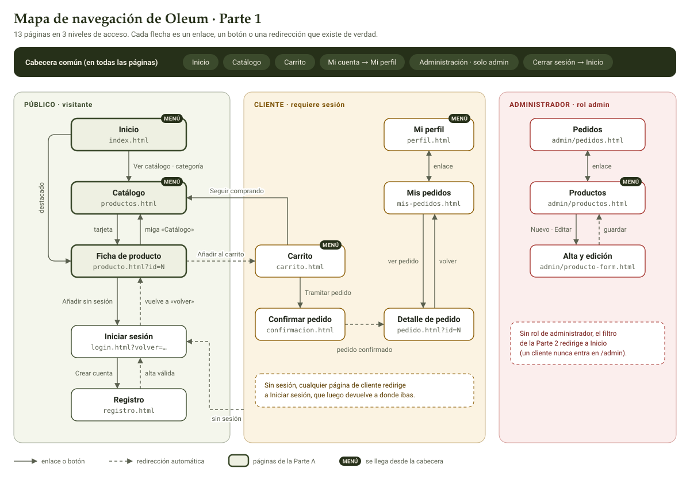

# Inventario de páginas y mapa de navegación

Oleum tiene 13 páginas repartidas en tres niveles de acceso: público, cliente y administrador. Salen de las páginas mínimas del apartado 5.2 del enunciado y de las historias de usuario. Cada una tiene un único dueño en el grupo y su ruta equivalente en la Parte 2.

> **Estado:** las historias de la Parte A (visitante, `VIS`) y la `CLI-01` están completas. Las del cliente y del administrador las añaden B y C; mientras tanto, sus páginas se justifican con los requisitos del apartado 3 del enunciado.

## Inventario de páginas

| Página | Fichero (Parte 1) | Ruta en la Parte 2 | Acceso | Qué contiene | Historias o requisitos | Dueño |
| --- | --- | --- | --- | --- | --- | --- |
| Inicio | `index.html` | `GET /` | Público | Portada, un aceite destacado por categoría y accesos al catálogo filtrado | VIS-01, VIS-13 | A |
| Catálogo | `productos.html` | `GET /productos` | Público | Búsqueda, filtros por categoría, variedad y precio, orden, filtros aplicados, tarjetas y paginación | VIS-02 a VIS-10, VIS-13 | A |
| Ficha de producto | `producto.html?id=N` | `GET /productos/{id}` (404 si no existe) | Público | Datos del aceite, precio por litro, existencias y formulario de compra | VIS-11, VIS-12, VIS-13, CLI-01 | A |
| Registro | `registro.html` | `GET/POST /registro` | Público | Formulario de alta con validación | 3.2 · historias de C | C |
| Iniciar sesión | `login.html?volver=…` | `GET/POST /login` | Público | Formulario de acceso; tras entrar, vuelve a la página de `volver` | 3.2, VIS-12 · historias de C | C |
| Carrito | `carrito.html` | `GET /carrito` · `POST /carrito/items/{id}` | Cliente | Líneas, cambiar cantidad, eliminar, subtotal y total | 3.1 · CLI-01 a CLI-04 | B |
| Confirmar pedido | `confirmacion.html` | Formulario previo a `POST /pedidos` *(propuesta)* | Cliente | Dirección de envío, resumen, pago ficticio y confirmación | 3.1, 3.3 · CLI-05 a CLI-09 | B |
| Detalle de pedido | `pedido.html?id=N` | `GET /mis-pedidos/{id}` *(propuesta)* | Cliente | Líneas con su precio guardado, total y estado | 3.1, 3.3 · CLI-11 | B |
| Mis pedidos | `mis-pedidos.html` | `GET /mis-pedidos` | Cliente | Historial de pedidos del usuario de la sesión | 3.1 · CLI-10 | B |
| Mi perfil | `perfil.html` | `GET/POST /perfil` *(propuesta)* | Cliente | Datos personales y dirección | 3.2 · CLI-12 | B |
| Productos (admin) | `admin/productos.html` | `GET /admin/productos` | Administrador | Listado con existencias, alta, edición y baja lógica | 3.2 · historias de C | C |
| Alta y edición de producto | `admin/producto-form.html` | `GET/POST /admin/productos/...` | Administrador | Formulario de producto con validación | 3.2 · historias de C | C |
| Pedidos (admin) | `admin/pedidos.html` | `GET /admin/pedidos` · `POST /admin/pedidos/{id}/estado` | Administrador | Pedidos y cambio de estado | 3.2 · historias de C | C |

Las rutas marcadas como *propuesta* no aparecen en el contrato del apartado 6.2. El enunciado admite variantes coherentes si se documentan, y esta tabla es esa documentación.

## Comprobaciones del inventario

- [x] Todas las historias del visitante y la CLI-01 tienen página.
- [x] Ninguna página de la Parte A queda sin historia.
- [x] Páginas de B completadas con sus historias (CLI-01 a CLI-12 en `historias-cliente.md`).
- [ ] Páginas de C con sus historias (cuando las mande).

## Mapa de navegación

Cómo se lee:

- **Las tres zonas** son los niveles de acceso. El color del borde de cada página indica quién puede verla.
- **La cabecera común** está en todas las páginas, así que sus enlaces se dibujan una sola vez, en la banda superior. Las páginas marcadas con **MENÚ** son sus destinos.
- **Flecha continua:** un enlace o un botón. **Flecha discontinua:** una redirección automática, por ejemplo tras iniciar sesión o tras guardar un formulario (el patrón Post/Redirect/Get del apartado 4.1).
- **Las notas discontinuas** de las zonas de cliente y de administrador describen lo que harán los filtros de autorización de la Parte 2.

## Comprobaciones del mapa

- [x] Se llega a cualquier página desde Inicio: a las del menú desde la cabecera, y al resto siguiendo flechas.
- [x] No hay callejones sin salida: todas las páginas llevan la cabecera común.
- [x] Solo se dibujan enlaces que existen o que el grupo ha acordado; no hay enlaces inventados.
- [x] Las páginas de cliente y de administrador están protegidas, y el mapa muestra a dónde se redirige si no hay permiso.

## Decisiones que hay que confirmar con B y C

1. **Después de «Añadir al carrito».** El apartado 6.2 dice que se redirige al carrito, y así se dibuja. Hasta la integración, la ficha muestra una confirmación, porque `carrito.html` aún no existe. En la fase 8 se cambia una línea de `detalle.js`.
2. **Enlace «Administración» de la cabecera:** solo se ve si `usuarioActual().rol` es `'admin'` (B, con la sesión de C).
3. **«Mi cuenta» y «Carrito» sin sesión:** llevan a `login.html?volver=…`, igual que la ficha.
4. **«Cerrar sesión»:** en la Parte 2 es un `POST /logout` (nunca un `GET`, como pide el enunciado), que redirige a Inicio.
